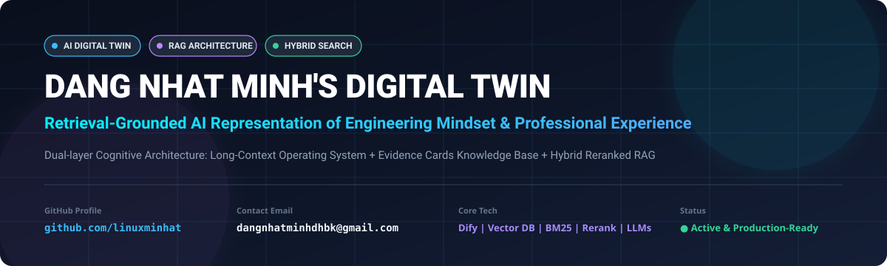
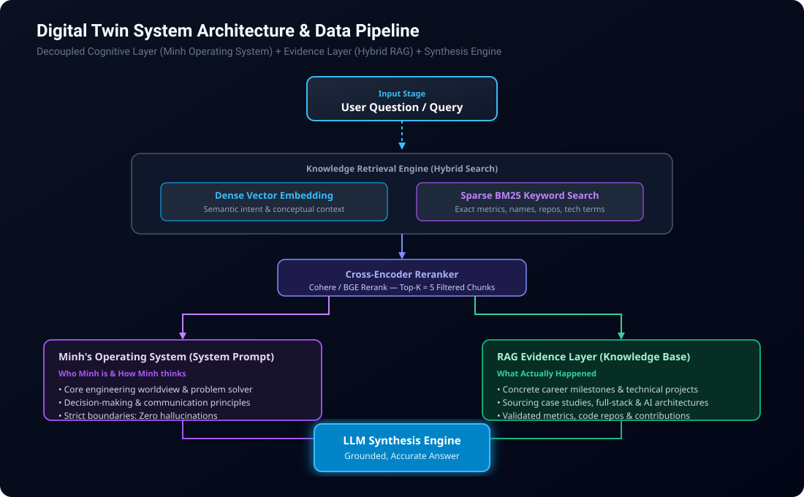
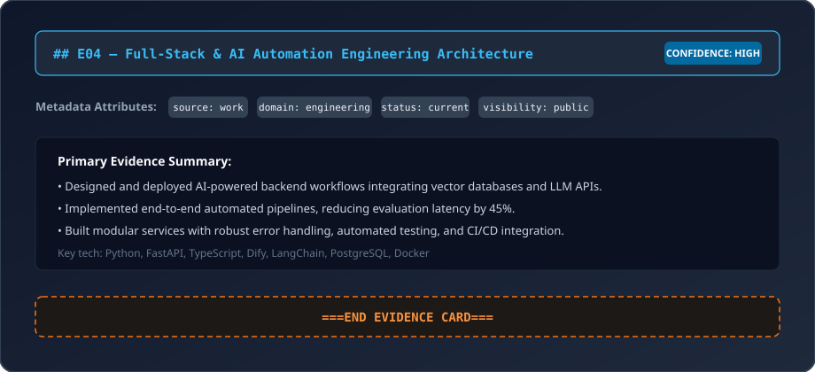

<div align="center">



# 🧠 Dang Nhat Minh's AI Digital Twin
### *Retrieval-grounded AI representation of an engineer's mindset, systems philosophy and verified portfolio*

[](https://github.com/linuxminhat/digital-twin/actions/workflows/ci.yml)
[](./pyproject.toml)
[](#-hybrid-retrieval-engine)
[](./dify/digital_twin_chatflow.yml)
[](./evaluation/benchmark_report.md)
[](https://github.com/linuxminhat)

</div>

---

## 📌 Contents

- [Overview](#-overview)
- [System Architecture](#-system-architecture)
- [Hybrid Retrieval Engine](#-hybrid-retrieval-engine)
- [Hallucination Guardrails](#-hallucination-guardrails)
- [Benchmark](#-benchmark)
- [Quickstart](#-quickstart) — CLI · Docker · Dify
- [Repository Structure](#-repository-structure)
- [CI/CD](#-cicd)
- [Featured Projects](#-featured-engineering-projects)
- [About the Author](#-about-the-author)

---

## 💡 Overview

A static resume can't show how an engineer reasons, and an ungrounded chatbot will happily invent
employers and metrics. This repository builds a **digital twin** of
**Dang Nhat Minh** ([`@linuxminhat`](https://github.com/linuxminhat)) that does neither:

| Layer | File | Role |
|---|---|---|
| 🧠 **Operating System** | [`prompts/minh-operating-system.md`](./prompts/minh-operating-system.md) | *Who Minh is and how he thinks*: persona, operating pattern, boundaries |
| 📑 **Evidence Layer** | [`knowledge-base/minh-primary-evidence.md`](./knowledge-base/minh-primary-evidence.md) | *What actually happened*: atomic, metadata-tagged evidence cards |
| 🔍 **Retrieval Engine** | [`src/`](./src) | Chunking, hybrid BM25 + dense search, RRF, reranking, refusal guardrail |
| 🔁 **Orchestration** | [`dify/digital_twin_chatflow.yml`](./dify/digital_twin_chatflow.yml) | One-click Dify chatflow with LLM synthesis and citation formatting |
| 📊 **Evaluation** | [`evaluation/`](./evaluation) | 30-case benchmark with P@5, Recall@5, MRR, latency and rejection rate |

---

## 🏗️ System Architecture



```text
User question
   │
   ├──► glossary query expansion   (cv → resume, database → mongodb, …)
   │
   ├──► BM25Okapi  (sparse) ─────┐   exact repo names, frameworks, IDs
   └──► Dense cosine (vector) ───┴──► Reciprocal Rank Fusion  Σ 1/(60 + rank)
                                          │
                                          ▼
                              Cross-encoder reranker (Top-10 → Top-K ≤ 5,
                              relative score threshold 0.6 × best)
                                          │
                                          ▼
                              Grounding guardrail ── refuse? ──► "I do not have verified evidence…"
                                          │ no
                                          ▼
                 Minh OS system prompt + cited evidence cards ──► LLM ──► Citation formatter ──► Answer
```

Full design notes: [`architecture/architecture.md`](./architecture/architecture.md).

---

## 🔍 Hybrid Retrieval Engine

### Chunking — [`src/chunker.py`](./src/chunker.py)



- Splits **only** on a standalone `===END EVIDENCE CARD===` line (inline mentions in prose are ignored).
- Extracts `card_id`, `title`, `domain`, `source_type`, `tags`, `confidence`, `source`, `timeline`
  from `**Field:**` header lines or an optional YAML front-matter block, validated with Pydantic.
- Rejects **text bleeding**: a chunk with two card headings (missing delimiter), an unterminated
  trailing card, duplicate IDs, missing required metadata or a chunk over 2,000 characters.

### Search — [`src/hybrid_search.py`](./src/hybrid_search.py)

| Stage | Default (offline, deterministic) | Drop-in neural backend |
|---|---|---|
| Sparse | `rank_bm25.BM25Okapi` over accent-folded, identifier-aware tokens | — |
| Dense | `HashingEmbedder`: signed feature hashing of word + char 3–5-grams, 1024-d, L2-normalised | `DT_EMBEDDER=sentence-transformers` (`all-MiniLM-L6-v2`) |
| Fusion | Reciprocal Rank Fusion, `k = 60`, candidate pool 10 | — |
| Rerank | `LexicalCrossReranker`: joint (query, card) score from IDF-weighted coverage, bigram phrase overlap and metadata hits | `DT_RERANKER=bge` (`BAAI/bge-reranker-base`) |
| Top-K | ≤ 5, pruned below 0.6 × best rerank score | — |

The defaults need no model downloads or API keys, so CI and the benchmark are reproducible.
Install the `neural` extra (`pip install -e ".[neural]"`) to switch to learned models.

---

## 🛡️ Hallucination Guardrails

A query is **refused** — the twin answers *"I do not have verified evidence regarding that specific
detail in my knowledge base."* — when any of these hold:

| # | Rule | Example caught |
|---|---|---|
| 1 | Asks for a **claim-bearing attribute** absent from the KB (compensation, business metrics, PII, employers, degrees) | *"How much revenue did ITSmartHire generate?"* |
| 2 | Mentions an **unknown named entity or identifier** (capitalised word, acronym or token with digits not in the KB) | *"Did Minh work at Google or Microsoft?"* |
| 3 | **More than half** of the query's content terms never occur in the KB | — |
| 4 | Best evidence covers **< 35 %** of the IDF-weighted query terms | — |

In the Dify flow, the same contract is enforced in the system prompt and by the *Citation Formatter*
node, which strips `[Exx]` citations to cards that were not retrieved.

---

## 📊 Benchmark

[`evaluation/benchmark_dataset.json`](./evaluation/benchmark_dataset.json): 30 cases in three categories.
Results from `python -m evaluation.eval_runner` (full table: [`benchmark_report.md`](./evaluation/benchmark_report.md)):

| Metric | Result |
|---|---|
| Precision@5 | **98.5 %** |
| Recall@5 | **100 %** |
| MRR | **1.000** |
| Hallucination rejection rate (category C) | **100 %** (8 / 8) |
| False refusal rate (categories A + B) | **0 %** (0 / 22) |
| Latency p50 | ~3 ms per query (local CPU, index build excluded) |

| Category | Cases | Pass |
|---|---|---|
| A — Exact factual retrieval (`ITSmartHire`, `smartIOTproject`, university, awards, certifications) | 12 | 12 |
| B — Systems & architectural reasoning (mindset, trade-offs, OS / evidence separation) | 10 | 10 |
| C — Out-of-domain / hallucination boundary (salary, unlisted employers, fake metrics, PII) | 8 | 8 |

> **Read these numbers honestly.** The knowledge base has six cards, so retrieval is easy, and the
> guardrail thresholds and glossary were tuned on these same 30 cases. They are a **regression
> baseline** — CI fails if Recall@5 drops below 90 %, rejection below 100 % or false refusals above
> 10 % — not an estimate of performance on unseen questions.

**Known limitations:** the lexical guardrail is English-centric. Vietnamese questions work when they
use terms that appear in the cards (e.g. *"Minh có học ở Đại học Bách Khoa không?"*) but are often
refused otherwise; use a multilingual embedder or the Dify LLM path for full bilingual support.

---

## 🚀 Quickstart

### 1. Local CLI

```bash
python -m venv .venv && source .venv/bin/activate     # Windows: .venv\Scripts\activate
pip install -r requirements.txt

python -m src.cli --query "Which embedding model was fine-tuned for CV to JD matching?" --debug
python -m src.cli --query "What was Minh's salary at Google?"     # → refusal
python -m src.cli                                                 # interactive REPL
```

```text
┌──── Q: Which embedding model was fine-tuned for CV to JD matching? ────┐
│ - AI / NLP Engineering: Fine-tuned the all-mpnet-base-v2 embedding     │
│ model to automatically calculate semantic relevance scores between     │
│ candidate resumes and job descriptions (JDs). [E02]                    │
└────────────────────────────────────────────────────────────────────────┘
```

The CLI is **extractive**: it only returns evidence lines, with `[Exx]` citations. Generative
synthesis happens in the Dify LLM node.

### 2. Docker

```bash
docker compose build                       # build fails if the benchmark gate fails
docker compose run --rm twin --query "What is ITSmartHire?"
docker compose run --rm twin               # interactive
docker compose run --rm eval               # run the benchmark
```

### 3. Dify (one-click import)

1. Create a Knowledge Base from `knowledge-base/minh-primary-evidence.md` with delimiter
   `===END EVIDENCE CARD===`, max length 2000, overlap 0, **Hybrid Search + Rerank**, Top-K 5.
2. Studio → **Import DSL file** → [`dify/digital_twin_chatflow.yml`](./dify/digital_twin_chatflow.yml).
3. Bind the *Evidence Retrieval* node to that Knowledge Base, confirm the LLM / rerank providers and publish.

`Start → Evidence Retrieval (Hybrid + Rerank) → System Prompt (Minh OS) → LLM Generation → Citation Formatter → End`

Details: [`dify/README.md`](./dify/README.md).

### 4. Benchmark & tests

```bash
pytest
python -m evaluation.eval_runner --report evaluation/benchmark_report.md \
    --min-recall 0.9 --min-rejection 1.0 --max-false-refusal 0.1
```

---

## 📂 Repository Structure

```plaintext
digital-twin/
├── .github/workflows/ci.yml           # lint, tests, benchmark gate, Docker build
├── architecture/architecture.md       # design notes
├── assets/                            # SVG banner, architecture and evidence-card diagrams
├── dify/
│   ├── digital_twin_chatflow.yml      # Dify advanced-chat DSL
│   └── README.md                      # import guide
├── evaluation/
│   ├── benchmark_dataset.json         # 30 labelled cases (A / B / C)
│   ├── eval_runner.py                 # P@5, Recall@5, MRR, latency, rejection rate, CI gates
│   └── benchmark_report.md            # generated report
├── knowledge-base/minh-primary-evidence.md   # evidence cards E00–E05
├── prompts/minh-operating-system.md   # Minh OS system prompt
├── src/
│   ├── chunker.py                     # evidence-card parser + validation
│   ├── hybrid_search.py               # BM25 + dense + RRF + rerank + guardrail
│   └── cli.py                         # rich CLI with citations
├── tests/                             # pytest suite (chunker, search, eval, Dify DSL)
├── Dockerfile · docker-compose.yml
└── pyproject.toml · requirements.txt
```

---

## ⚙️ CI/CD

[`ci.yml`](./.github/workflows/ci.yml) runs on every push and PR to `main`:

1. **test** (Python 3.10 & 3.12) — `ruff check`, `ruff format --check`, `pytest`, KB chunk validation.
2. **benchmark** — runs the 30-case suite with quality gates, publishes the report to the job summary and uploads it as an artifact.
3. **docker** — builds the image (which re-runs the gate) and smoke-tests a query.

---

## 🛠️ Featured Engineering Projects

| Project | Domain | Core Stack | Highlight | Card |
|---|---|---|---|---|
| **AI Digital Twin Platform** | AI agent & RAG | Dify, hybrid search, rerank, Python | Decoupled OS prompt from evidence cards; cited answers with refusal boundaries | E01 |
| **ITSmartHire** | AI recruitment | ReactJS, NestJS, FastAPI, MongoDB, Firebase | Fine-tuned `all-mpnet-base-v2` for CV-to-JD matching; Google Meet scheduling | E02 |
| **Microservices Library System** | Distributed backend | Java Spring Boot, ReactJS, TypeScript | Inventory, circulation, inquiry and review services as separate failure domains | E03 |
| **smartIOTproject** | Embedded / edge AI | Arduino UNO, ESP32-CAM | Camera streaming, sensor telemetry and event notifications | E04 |

---

## 👤 About the Author

<table border="0">
  <tr>
    <td width="100" align="center" valign="middle">
      
    </td>
    <td>
      <strong>Dang Nhat Minh</strong> (<code>@linuxminhat</code>)<br/>
      <em>Software &amp; AI Automation Engineer</em><br/>
      🎓 <strong>Da Nang University of Science and Technology (DUT)</strong> — Excellent Student Award<br/>
      📜 Anthropic <em>Claude Code in Action</em> · ArangoDB NoSQL · AWS Cloud Practitioner Essentials · mgm DevOps<br/>
      🌐 <a href="https://github.com/linuxminhat">github.com/linuxminhat</a> · 📫 <a href="mailto:dangnhatminhdhbk@gmail.com">dangnhatminhdhbk@gmail.com</a>
    </td>
  </tr>
</table>

---

## 📜 Acknowledgements

- Original digital-twin concept: [tom-agentbuilder/digital-twin](https://github.com/tom-agentbuilder/digital-twin).
- Retrieval engine, evaluation suite, Dify flow, infrastructure and knowledge base: [Dang Nhat Minh (@linuxminhat)](https://github.com/linuxminhat).
