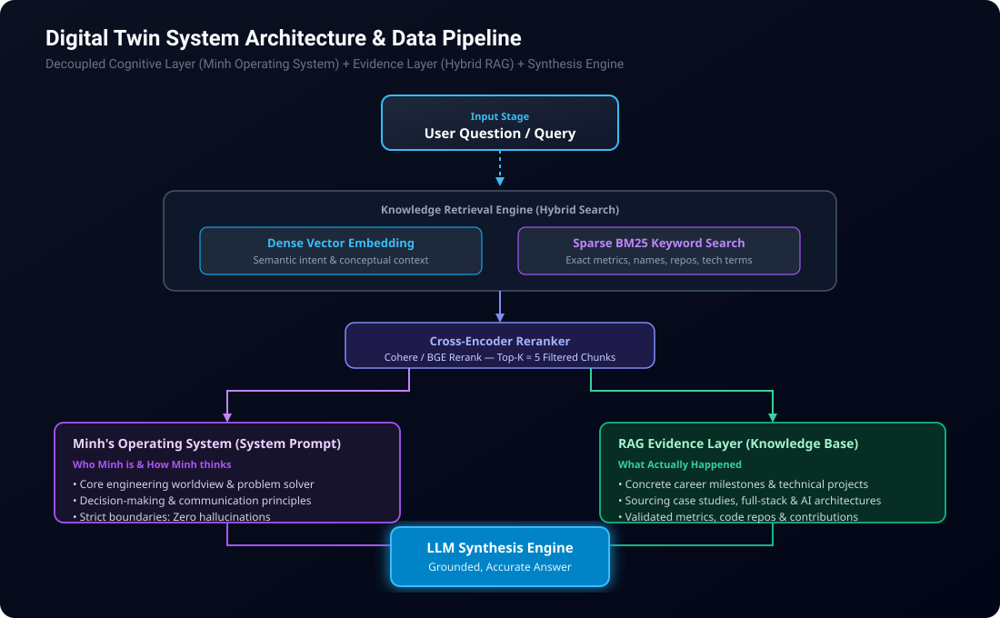
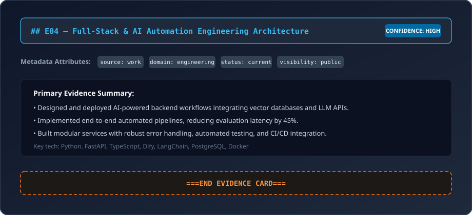

# Digital Twin — System Architecture & Implementation



## 1. Executive Summary

This project establishes a production-grade blueprint for constructing an **AI Digital Twin**—a conversational, grounded cognitive representation of a professional's identity, engineering expertise, and real-world accomplishments.

Traditional static CVs and generic conversational bots fail to capture the nuanced depth of an engineer. A static resume is lifeless and rigid; an ungrounded LLM hallucinates wildly. This system solves both failures by establishing a strict architectural separation:

> **The Operating System tells the AI *how to think and reason*.**  
> **The Evidence Layer tells the AI *what actually happened*.**

---

## 2. Architectural Blueprint

```text
                             USER
                               │
                               ▼
                      ┌──────────────────┐
                      │   User Question  │
                      └────────┬─────────┘
                               │
                               ▼
                      ┌──────────────────┐
                      │ Knowledge        │
                      │ Retrieval Engine │
                      └────────┬─────────┘
                               │
                               ▼
                      ┌──────────────────┐
                      │  Hybrid Search   │
                      │                  │
                      │ Semantic Vector  │
                      │ + Sparse BM25    │
                      └────────┬─────────┘
                               │
                               ▼
                      ┌──────────────────┐
                      │ Cross-Encoder    │
                      │    Reranker      │
                      └────────┬─────────┘
                               │
                               ▼
                      ┌──────────────────┐
                      │ Filtered Evidence│
                      │   (Top-K = 5)    │
                      └────────┬─────────┘
                               │
                   ┌───────────┴───────────┐
                   │                       │
                   ▼                       ▼
          ┌──────────────────┐    ┌──────────────────┐
          │ Operating System │    │  Evidence / RAG  │
          │                  │    │                  │
          │ • Minh Persona   │    │ • Actual Metrics │
          │ • Principles     │    │ • Project Proofs │
          │ • Decision Model │    │ • Repositories   │
          │ • Guardrails     │    │ • Case Studies   │
          └────────┬─────────┘    └────────┬─────────┘
                   │                       │
                   └──────────┬────────────┘
                              ▼
                      ┌──────────────────┐
                      │   LLM Engine     │
                      │                  │
                      │ Synthesis +      │
                      │ Grounded Output  │
                      └────────┬─────────┘
                               │
                               ▼
                        GROUNDED ANSWER
```

---

## 3. Core Architectural Layers

### Layer A: The Long-Context Operating System
The **Operating System** resides in the system prompt (`prompts/minh-operating-system.md`). It encodes immutable characteristics that must remain persistent across all conversations:
- **Professional Persona:** Identity, ethos, domain focus, and career narrative.
- **Problem-Solving Methodology:** First-principles deconstruction, systems thinking, iterative prototyping.
- **Communication Guidelines:** Crisp, structured, humble, and evidence-oriented communication.
- **Strict Guardrails:** Explicit instructions to refuse speculation when factual evidence is absent.

### Layer B: The RAG Evidence Layer
The **Evidence Layer** (`knowledge-base/minh-primary-evidence.md`) acts as the deterministic ground truth. It is structured into atomic **Evidence Cards**:
- **Independent Context:** Each card is completely self-contained, eliminating dependencies on surrounding paragraphs.
- **Bounded Delimiters:** Cards are segmented with explicit `===END EVIDENCE CARD===` boundary markers.
- **Rich Metadata:** Tagging across domains (`software_engineering`, `ai_automation`, `iot`, etc.), verification status, and confidence levels.



---

## 4. Retrieval & Ingestion Pipeline

### 1. Chunking Specification
- **Method:** Structured General Chunking
- **Max Chunk Size:** 2,000 characters
- **Chunk Overlap:** 0 (cards are self-contained; overlap introduces redundant noise)
- **Hard Boundary:** `===END EVIDENCE CARD===`

### 2. Hybrid Search Strategy
Real user queries are heterogeneous:
- **Semantic Queries** (e.g., *"How does Minh approach system scalability?"*) require dense vector embeddings (e.g., `text-embedding-3-large` or `bge-m3`).
- **Exact Identifier Queries** (e.g., *"What does smartIOTproject do?"*, *"Which model did ITSmartHire fine-tune — all-mpnet-base-v2?"*) require sparse lexical matching (BM25).

Hybrid search merges reciprocal rank scores from both approaches, guaranteeing zero recall drop for proper nouns, repository names, or specific technology terms.

### 3. Cross-Encoder Reranking
- **Model:** `rerank-english-v3.0` / `bge-reranker-large`
- **Top-K:** Calibrated to **5 chunks** to balance informational breadth with LLM context noise.
- **Score Threshold:** Dynamically evaluated to prune low-relevance chunks.

---

## 5. Factual Grounding & Hallucination Mitigation

The primary challenge of professional digital twins is preventing over-promising or fabricated credentials. This architecture enforces three layers of defense:

1. **System Prompt Constraint:** *"Do not invent achievements, employers, metrics, or opinions not supported by the approved knowledge base."*
2. **Citation Injection:** Responses cite specific evidence card IDs (`E01`, `E02`, etc.) when reporting numerical claims or historical milestones.
3. **Graceful Degradation:** When evidence is missing, the model is calibrated to declare: *"I don't have verified data on that topic in my current knowledge base."*
